# Dixel RP · Portal de información

Portal web de **Dixel RP**, servidor de rol de GTA San Andreas (SA:MP). Reúne en un solo sitio todo lo que necesita un jugador: cómo empezar, normas, conceptos de rol, sanciones, facciones, descargas, Staff y enlaces de la comunidad.

Es una web **estática** (HTML, CSS y JavaScript sin frameworks ni compilación): se sube tal cual a cualquier hosting.

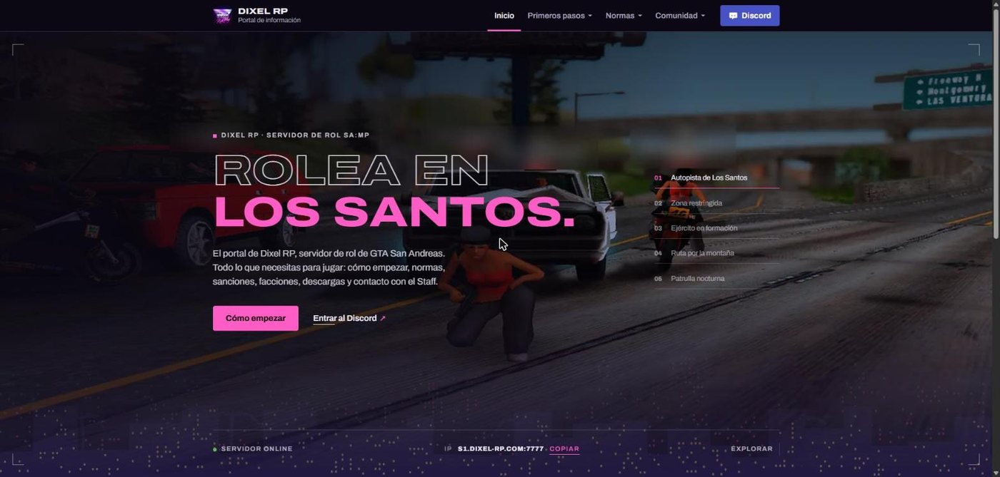

---

## Índice

1. [Qué se ha hecho](#qué-se-ha-hecho)
   - [Estructura y navbar compartido](#1-estructura-y-navbar-compartido)
   - [SEO](#2-seo)
   - [Navbar por categorías y botón de Discord](#3-navbar-por-categorías-y-botón-de-discord)
   - [Contenido nuevo de «Cómo empezar»](#4-contenido-nuevo-de-cómo-empezar)
   - [Portada con capturas y anime.js](#5-portada-con-capturas-y-animejs)
   - [Páginas de sección rediseñadas](#6-páginas-de-sección-rediseñadas)
   - [Sanciones: buscador y colores](#7-sanciones-buscador-y-colores)
   - [Responsive](#8-responsive)
   - [Accesibilidad y rendimiento](#9-accesibilidad-y-rendimiento)
2. [Estructura de carpetas](#estructura-de-carpetas)
3. [Cómo editar el contenido](#cómo-editar-el-contenido)
4. [Probar en local](#probar-en-local)
5. [Pendiente antes de publicar](#pendiente-antes-de-publicar)

---

## Qué se ha hecho

### 1. Estructura y navbar compartido

- Cada sección es su propio archivo `.html` (`rol.html`, `sanciones.html`…) con una dirección propia, buena para compartir y para buscadores.
- Los HTML son solo un «esqueleto»: dicen qué página son con `<body data-page="...">` y el contenido se dibuja desde `js/data.js`.
- **La barra superior, el menú y el pie se generan desde un único archivo** (`js/layout.js`). Para cambiar un enlace del menú se toca un solo sitio y se actualiza en todas las páginas.

### 2. SEO

- Título, descripción y dirección canónica propios en cada página.
- Etiquetas Open Graph para que el enlace se vea bien al compartirlo en Discord, WhatsApp o redes.
- `sitemap.xml` y `robots.txt`.
- Datos estructurados (JSON-LD) generados automáticamente:
  - **Inicio:** `WebSite` y `Organization` con las redes oficiales.
  - **Secciones:** `BreadcrumbList` (la ruta Inicio › Sección).
  - **FAQ:** `FAQPage`, que permite que Google muestre las preguntas directamente en los resultados.

### 3. Navbar por categorías y botón de Discord

Las 11 secciones se agrupan en tres categorías con desplegables que incluyen una breve descripción de cada página:

| Categoría | Secciones |
|---|---|
| **Primeros pasos** | Cómo empezar · Descargas · Preguntas frecuentes |
| **Normas** | Normas del servidor · Conceptos de rol · Sanciones · Reglas de Discord · Ciberacoso |
| **Comunidad** | Facciones · Staff y contacto · Enlaces |

A la derecha está el botón **Discord**, con el color oficial de Discord para distinguirlo del resto. La categoría de la página actual queda subrayada en rosa.

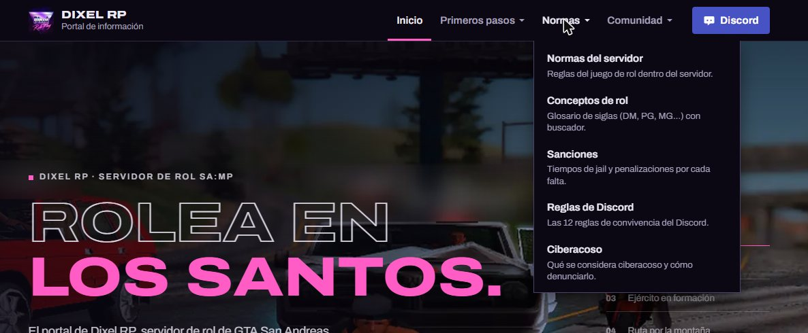

### 4. Contenido nuevo de «Cómo empezar»

Se revisó la antigua guía de rol.dixel-rp.com y se incorporó lo útil:

- Recuadro con la **IP del servidor** y botones para **Conectar** (abre SA-MP directamente) y **Copiar IP**.
- Pasos numerados para entrar por primera vez.
- Sobre SA-MP solo se recomienda usar una versión actualizada; cualquier versión compatible permite entrar.
- **Requisitos del PC:** los mismos del juego original, o incluso menores gracias a los GTA optimizados de la sección Descargas.
- Apartado «Recluta a un amigo» y enlace al Discord (`discord.gg/D8T9nZ4`).
- Se quitaron el launcher (desactualizado) y la versión de Android (no disponible).
- Cinco preguntas nuevas en la FAQ.

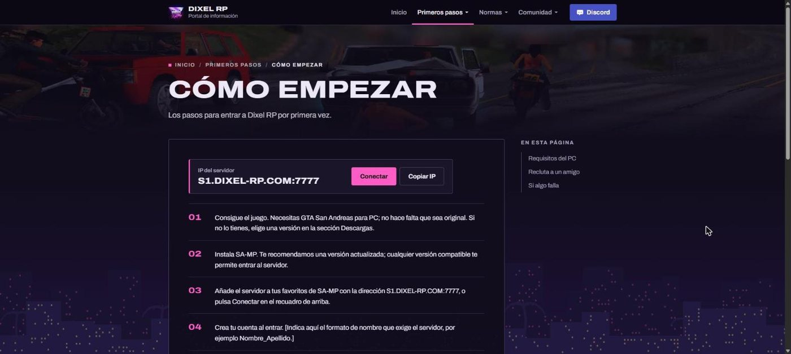

### 5. Portada con capturas y anime.js

La portada usa **capturas reales del servidor** (carpeta `img/background`), recortadas, convertidas a WebP y con los **nombres de jugadores difuminados**. **anime.js** solo se usa en la portada.

- **Entrada animada:** primero se dibujan las esquinas de visor, después el título sube línea a línea y el resto aparece en cascada.
- **Carrusel de 5 capturas** con una cortinilla y una línea rosa que cruza la imagen, más un zoom lento mientras se ve cada una.
- **Índice de capturas** a la derecha: barra de progreso y salto a cualquier captura.
- **Barra inferior** con el estado del servidor (punto que late), la IP con botón de copiar y el indicador «Explorar».
- **Fundido inferior:** la captura se disuelve en el fondo animado de la ciudad, sin cortes entre la portada y el contenido.
- El carrusel **se detiene** cuando la portada no está a la vista o la pestaña está oculta.

Debajo de la portada están las **cifras del portal** (se calculan solas a partir del contenido y cuentan al aparecer) y el **índice completo** por categorías.

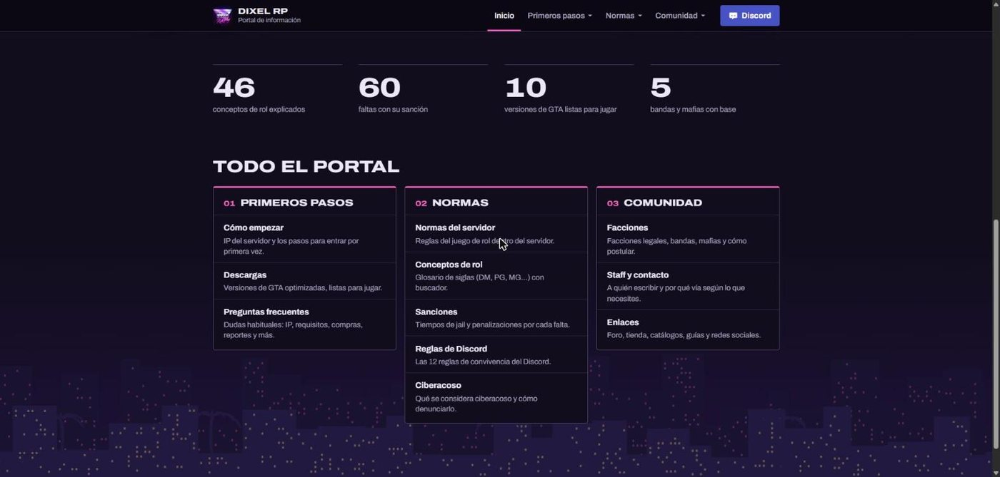

### 6. Páginas de sección rediseñadas

Todas las secciones comparten el mismo lenguaje visual de la portada.

**Cabecera.** Muestra la ruta (Inicio / Categoría / Sección), el título y la entradilla. Al fondo lleva una captura difuminada que cambia según la categoría:

| Categoría | Captura |
|---|---|
| Primeros pasos | Autopista |
| Normas | Zona restringida |
| Comunidad | Ejército |

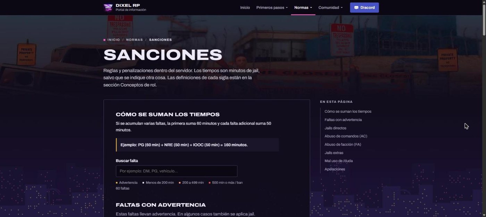

**Índice «En esta página».** Aparece en las páginas con 3 apartados o más.

- En escritorio va fijo a la derecha y **marca en rosa el apartado que se está leyendo**; en móvil es un desplegable.
- Cada título tiene un enlace `#` para compartir un punto concreto, por ejemplo `rol.html#vehiculos`. Al abrir ese enlace, la página baja directamente a ese apartado.

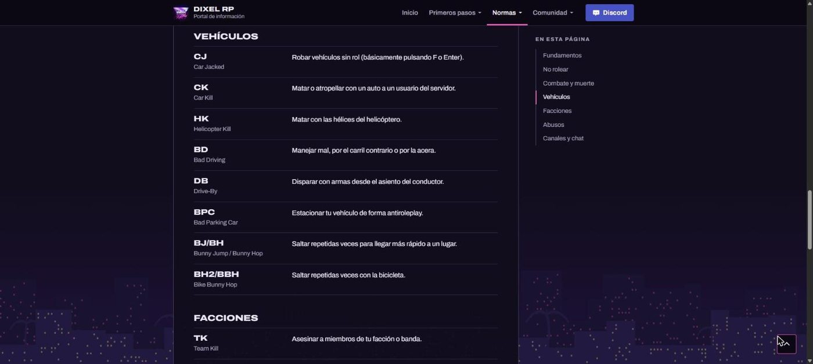

**Anterior / Siguiente y Volver arriba.** Al final de cada página hay enlaces a la sección anterior y a la siguiente, en el orden del menú. En las páginas largas aparece además el botón **Volver arriba**.

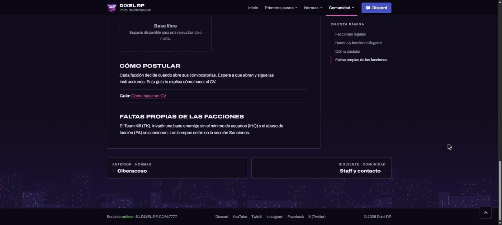

**Otras secciones.** Facciones muestra las bases (HQ) con su foto ampliable y el color de cada banda. Descargas presenta cada versión de GTA con su vídeo, que solo se carga al pulsar *play*.

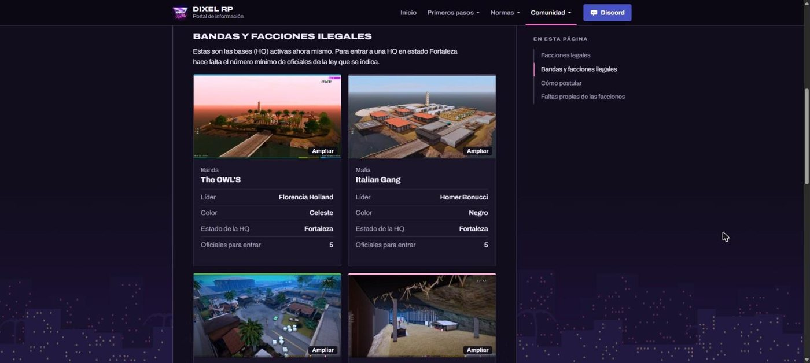

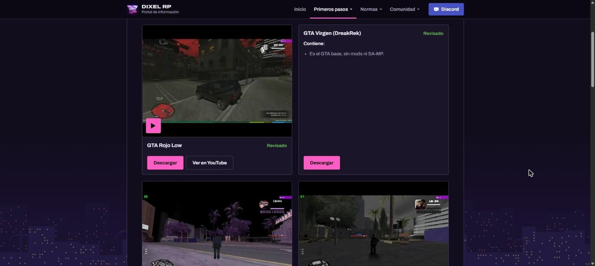

### 7. Sanciones: buscador y colores

- **Buscador** de faltas, igual que el del glosario de Conceptos de rol. No distingue mayúsculas ni acentos.
- Mientras buscas, se ocultan los apartados vacíos y el índice lateral se actualiza.
- **Cada duración lleva un color según su peso**, con una leyenda debajo del buscador:
  - dorado: advertencia;
  - blanco: menos de 200 min;
  - naranja: de 200 a 499 min;
  - rojo: 500 min o más, y el ban.

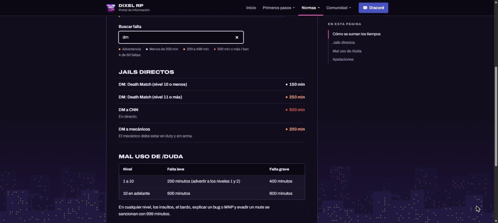

### 8. Responsive

Todas las páginas se han revisado entre 320 px y 1568 px de ancho, sin scroll horizontal.

- En móvil el menú es una lista agrupada por categorías. En pantallas muy estrechas, el botón de Discord pasa al final del menú.
- Las tablas se convierten en fichas apiladas, en las que cada dato muestra el nombre de su columna.
- El índice «En esta página» se pliega y los botones ocupan todo el ancho.

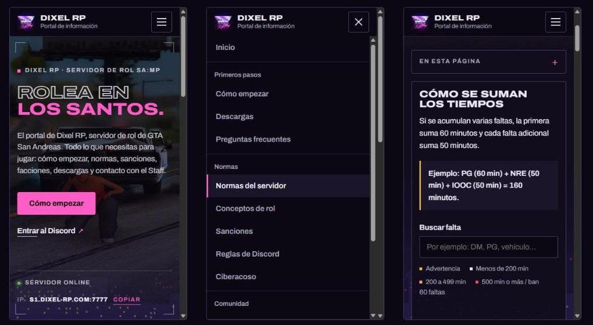

### 9. Accesibilidad y rendimiento

- **Teclado y lectores de pantalla:** enlace «Saltar al contenido», foco visible, menús que se cierran con Escape y textos alternativos.
- **Menos movimiento:** si el sistema lo pide, la portada se muestra fija, sin carrusel ni animaciones.
- **Mejora progresiva:** si anime.js no carga, la web se ve completa y el índice de capturas sigue permitiendo cambiar de imagen (sin transición).
- **Imágenes:** WebP en dos tamaños (800 y 1600 px). La primera captura se pide con prioridad y el resto se carga después. anime.js se carga con verificación de integridad (SRI).
- **Ahorro de recursos:** el fondo animado y el carrusel se pausan con la pestaña oculta.

---

## Estructura de carpetas

```
Potal_Reglas/
├── index.html, empezar.html, rol.html …   Una página por sección (+ 404.html)
├── robots.txt, sitemap.xml                SEO
├── css/
│   └── styles.css                         Todos los estilos
├── js/
│   ├── data.js                            CONTENIDO: textos, menú, IP, redes…
│   ├── layout.js                          Barra superior, menú y pie (compartidos)
│   ├── app.js                             Dibuja las páginas a partir de data.js
│   └── home.js                            Animaciones de la portada (anime.js)
├── img/
│   ├── background/                        Capturas originales (sin usar en la web)
│   ├── hero/                              Capturas de la portada en WebP (800/1600)
│   ├── bases/                             Fotos de las HQ de bandas y mafias
│   └── dixel-logo.png
└── docs/capturas/                         Imágenes de este README
```

## Cómo editar el contenido

Casi todo se cambia en **`js/data.js`**, sin tocar HTML:

| Quiero cambiar… | Dónde, en `data.js` |
|---|---|
| IP, puerto, Discord, redes sociales | `site` |
| Textos y capturas de la portada | `home` |
| Menú y categorías | `nav` |
| Captura de la cabecera de cada categoría | `groupImages` |
| Contenido de una sección | `pages.<id>.blocks` |

Cada sección es una lista de **bloques**: `intro`, `heading`, `rules`, `cards`, `table`, `faq`, `glossary`, `sanctions`, `downloads`, `bases` o `server`. El formato de cada tipo está explicado al principio de `data.js`.

- **Índice lateral:** se genera solo a partir de los bloques `heading`.
- **Anterior / Siguiente:** sigue el orden de `nav`.

Para ajustar los tiempos de la portada (duración de cada captura, cortinilla, zoom), cambia `HOME_MOTION` en `js/home.js`.

## Probar en local

Hace falta un servidor local (abriendo el archivo directamente algunas funciones no van):

```bash
python -m http.server 8765
```

y abrir <http://localhost:8765>.

## Pendiente antes de publicar

- [ ] Sustituir `https://TU-DOMINIO` por el dominio real en los `.html`, `sitemap.xml` y `robots.txt`.
- [ ] Indicar el formato de nombre de personaje (paso 4 de «Cómo empezar»).
- [ ] Escribir las descripciones de las facciones legales (SAAR, CNN, Mecánicos).
- [ ] Revisar los textos marcados entre corchetes `[...]` en `data.js`.
